# Zeiterfassung für Synology

[](https://github.com/rinkelzz/zeiterfassung/actions/workflows/ci.yml)
[](https://github.com/rinkelzz/zeiterfassung/releases)
[](LICENSE)

Kommen/Gehen-Zeiterfassung für kleine Teams, die auf der eigenen Synology NAS läuft – als Paket
mit eigenem Fenster in DSM. Gestempelt wird im Browser, per iPhone-Kurzbefehl, automatisch beim
Ankommen (Standort) oder mit einem NFC-Aufkleber. Gleitzeit, Überstunden und Urlaub werden mitgeführt,
Berichte gibt es als PDF und Excel – auf Wunsch jeden Monat automatisch per Mail.

[](https://buymeacoffee.com/lapalutschi)

Dir gefällt die Zeiterfassung? Über einen Kaffee freue ich mich – die App bleibt natürlich kostenlos.

*English summary: [below](#english).*

| Übersicht mit Team | Monat mit Hinweisen und Ü-Tag |
|---|---|
| 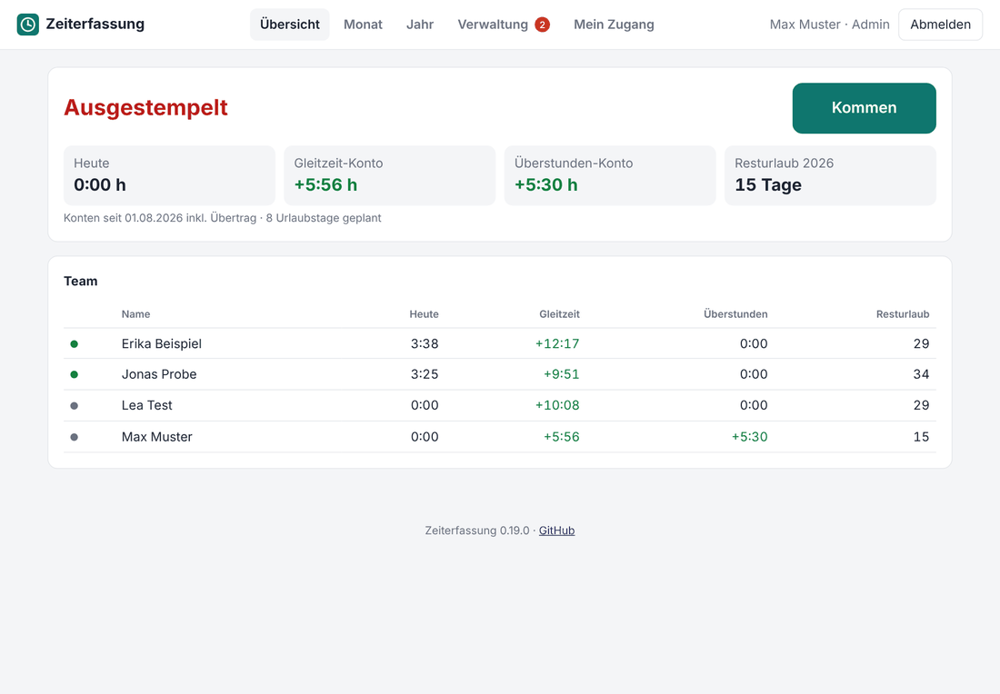 | 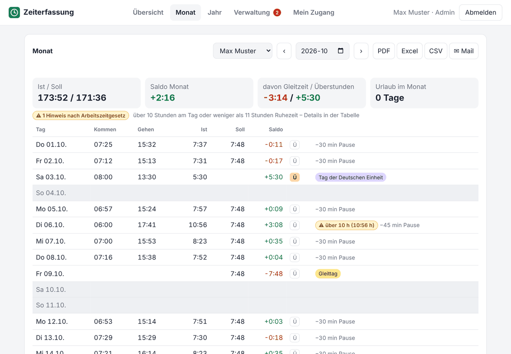 |

| Kiosk-Tablet einer Filiale | Nach der PIN: Kontostände und Gehen |
|---|---|
| 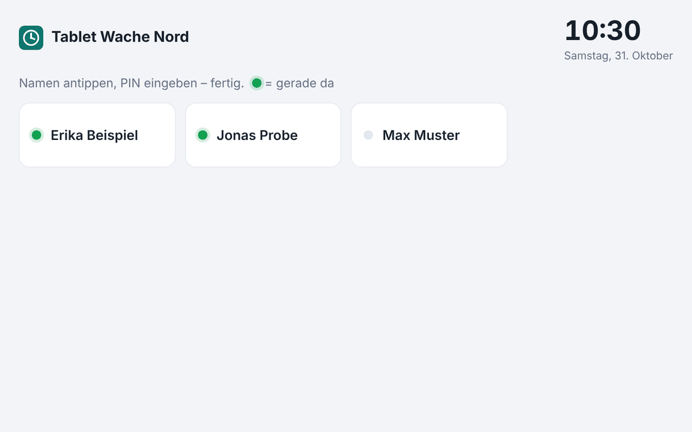 | 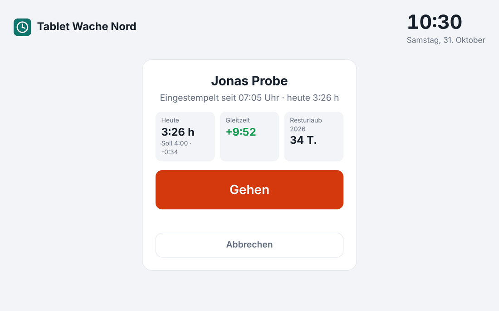 |

| Verwaltung: Mitarbeiter bearbeiten | Verwaltung: Einstellungen |
|---|---|
| 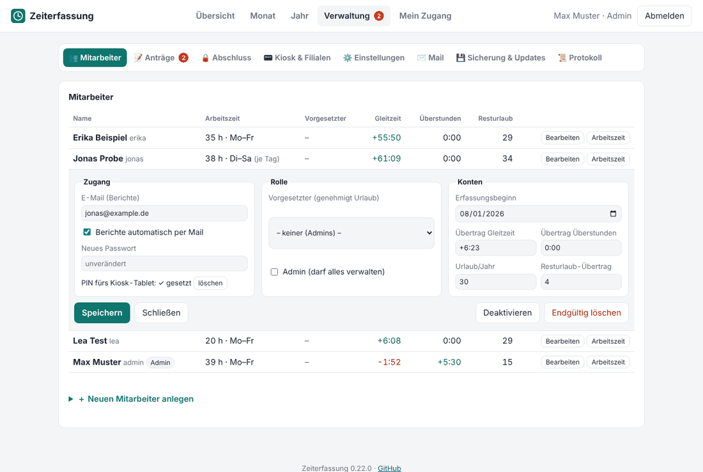 | 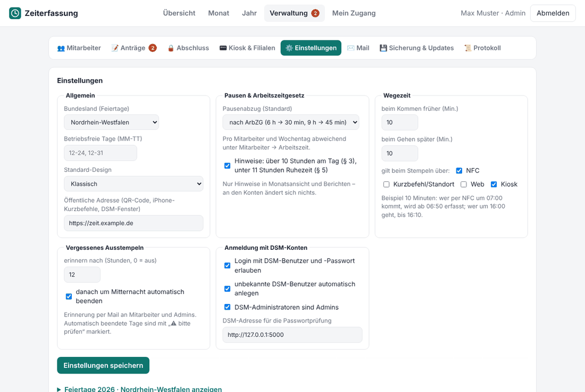 |

| Stunden und Pausen je Wochentag | Filialen und Tablets |
|---|---|
| 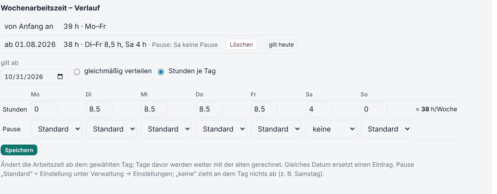 | 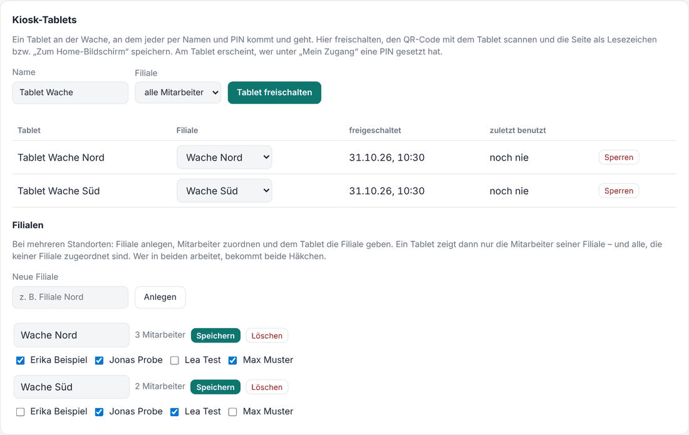 |

| Korrekturanträge | Monatsabschluss |
|---|---|
| 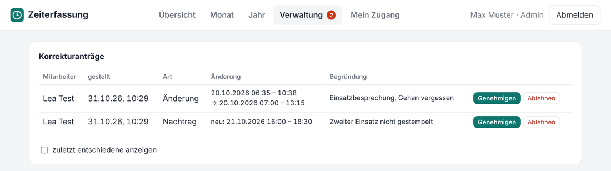 | 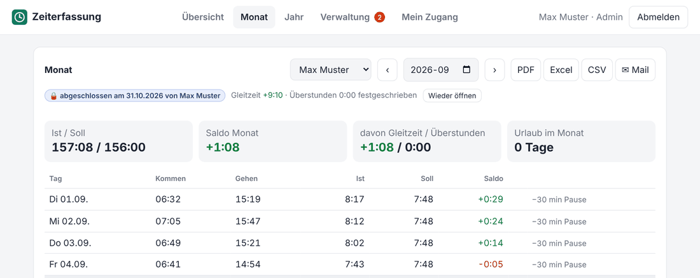 |

| Abwesenheitskalender (Admins und Vorgesetzte) | Stempel-Link per NFC-Aufkleber |
|---|---|
| 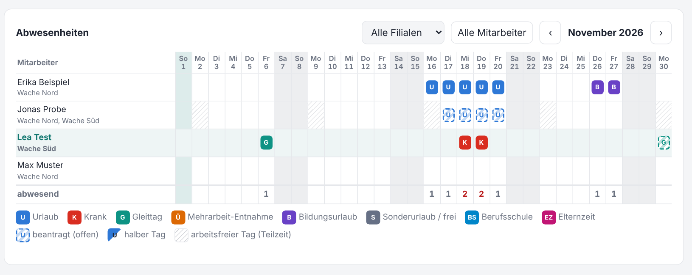 | 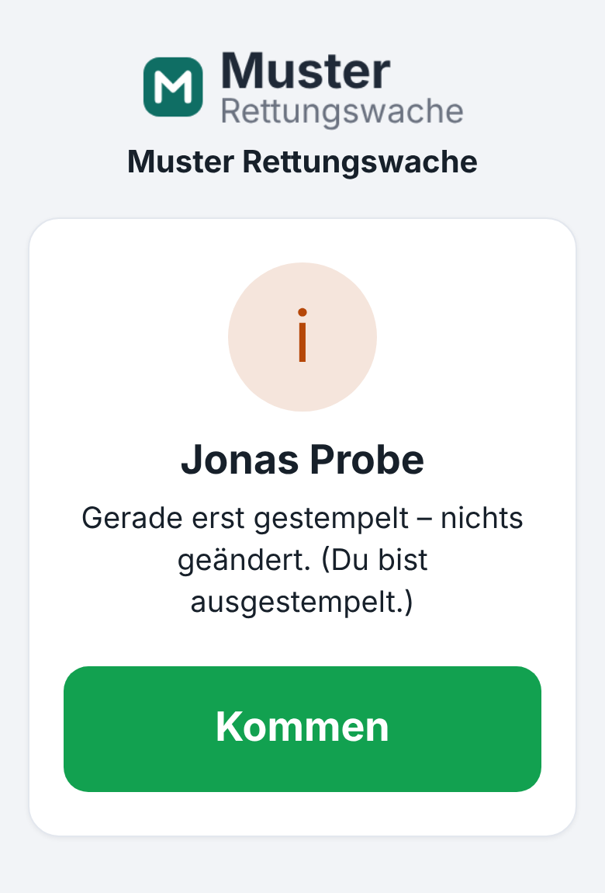 |

| Jahreskalender | Änderungsprotokoll |
|---|---|
| 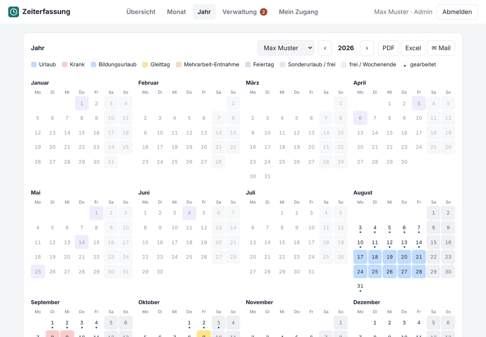 | 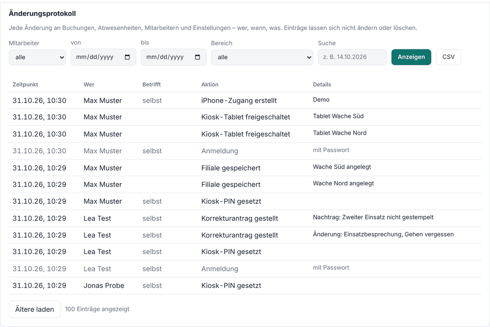 |

**Vier Designs zur Auswahl** – Klassisch, Synology DSM, Nacht und Warm & groß:

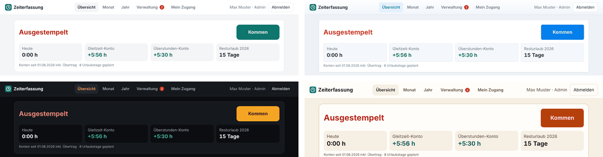

| Arbeitszeitnachweis (PDF, mit Stunden je Wochentag) | iPhone-Einrichtung |
|---|---|
| 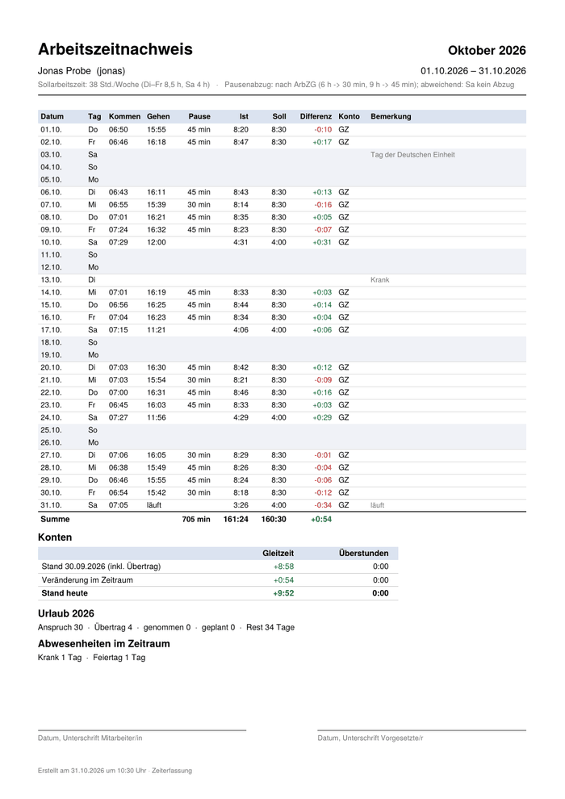 | 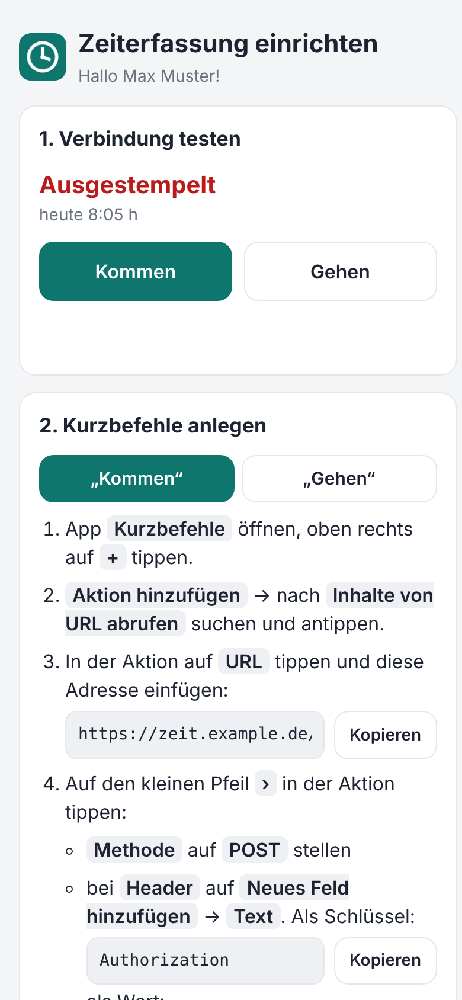 |

> Alle Namen und Zahlen in den Screenshots sind erfunden.

## Inhalt

- [Funktionen](#funktionen)
- [Installation](#installation-auf-der-synology) · [Updates](#updates-über-das-paket-zentrum) ·
  [Datensicherung](#datensicherung) · [Von unterwegs (Reverse Proxy)](#von-unterwegs-erreichbar-machen-reverse-proxy) ·
  [iPhone & NFC](#iphone-und-nfc-einrichten) · [Kiosk-Tablet](#kiosk-tablet) · [Berichte per Mail](#berichte-per-mail) ·
  [Vergessenes Ausstempeln](#vergessenes-ausstempeln) · [Korrekturanträge](#korrekturanträge) ·
  [Monatsabschluss](#monatsabschluss) · [Arbeitszeit & Pausen je Wochentag](#arbeitszeit-und-pausen-je-wochentag) · [Feiertage](#feiertage) · [Urlaubsanträge](#urlaubsanträge-und-vorgesetzte) ·
  [Mitarbeiter deaktivieren oder löschen](#mitarbeiter-deaktivieren-oder-löschen)
- [Entwicklung](#entwicklung) · [Hinweise](#hinweise) · [Lizenz](#lizenz) · [English](#english)

## Funktionen

**Stempeln**
- Weboberfläche (auch am Handy), iPhone-Kurzbefehle, Standort-Automation, NFC-Aufkleber
- **Stempel-Link** ohne Kurzbefehle: Symbol auf dem Home-Bildschirm oder NFC-Aufkleber mit Web-Adresse –
  ein Aufkleber für das ganze Team, er enthält keinen persönlichen Schlüssel
- **Kiosk-Tablet** an der Wache: Name antippen, PIN eingeben, Kommen/Gehen – mit Anzeige, wer gerade da ist,
  den eigenen Kontoständen nach der PIN und Filialen für mehrere Standorte; pro Tablet einstellbar: große oder kleine
  Kacheln oder Liste, Anwesende zuerst, Anzeigedauer der Bestätigung (2–15 Sekunden, Antippen schließt sofort)
- Einrichtung fürs iPhone per **QR-Code**: persönliche Seite mit Test-Knöpfen und Kopier-Feldern
- **Umschalten** mit einem einzigen NFC-Aufkleber (kommt, wenn draußen – geht, wenn drin)
- **Wegezeit**: für gewählte Stempelwege (z. B. NFC) beim Kommen früher und beim Gehen später, z. B. je 10 Minuten
- **Vergessenes Ausstempeln:** Erinnerung per Mail nach 12 Stunden, um Mitternacht automatisch beendet
  und als „bitte prüfen“ markiert
- Doppelte Auslöser sind harmlos; Dienste über Mitternacht werden sauber aufgeteilt (auch bei Zeitumstellung)

**Konten und Auswertung**
- **Gleitzeit- und Überstunden-Konto** getrennt: „Ü“-Tage schieben die Zeit über dem Tagessoll aufs Überstunden-Konto
- **Wochenarbeitszeit mit Verlauf** („ab 01.03. 30 Std. an Mo–Do“) – alte Monate bleiben richtig;
  auf Wunsch **Stunden je Wochentag** (z. B. 38 h: Di–Fr 8,5 h, Sa 4 h)
- Urlaubskonto mit Resturlaub-Übertrag; Abwesenheiten (Urlaub, Krank, Bildungsurlaub, Gleittag,
  Mehrarbeit-Entnahme, Sonderurlaub, **Berufsschule**, **Elternzeit**), auch als halber Tag –
  Berufsschule zählt wie ein erfüllter Arbeitstag, Elternzeit hat kein Soll und verbraucht keinen Urlaub
- Feiertage aller 16 Bundesländer, regionale Feiertage zum Ankreuzen (z. B. Fronleichnam in Teilen von Sachsen
  und Thüringen, Augsburger Friedensfest), betriebsfreie Tage, Erfassungsbeginn und Überträge pro Person
- Pausenabzug wählbar: keiner, nach ArbZG (über 6 h: 30 min, über 9 h: 45 min) oder fest –
  pro Mitarbeiter auch **je Wochentag** abweichend (z. B. samstags kein Abzug)
- **Vier Designs:** Klassisch (folgt hell/dunkel des Geräts), Synology DSM, Nacht (immer dunkel) und Warm & groß
  (größere Schrift und Knöpfe) – jeder wählt selbst unter „Mein Zugang“, der Admin legt den Standard fest
- **Firmenname und -logo** in Kopfzeile, Anmeldung, Kiosk-Tablet sowie in PDF- und Excel-Berichten
  (Verwaltung → Einstellungen → Allgemein; PNG oder JPEG bis 1 MB, steckt in jeder Sicherung)
- Mitarbeiter **deaktivieren** (Daten bleiben) oder **endgültig löschen** (mit Namensbestätigung und automatischer Sicherung vorher)
- **Hinweise nach Arbeitszeitgesetz:** über 10 Stunden am Tag (§ 3), unter 11 Stunden Ruhezeit (§ 5) –
  in Monatsansicht und Berichten markiert, abschaltbar
- Monatsansicht zum Korrigieren, Jahreskalender zum Eintragen von Abwesenheiten per Ziehen
- **Korrekturanträge:** Mitarbeiter beantragen Nachtrag, Änderung oder Löschung einer Buchung; der Admin
  genehmigt per Klick (wird übernommen) oder lehnt mit Begründung ab – mit Mail an beide Seiten
- **Urlaubsanträge:** Mitarbeiter beantragen Urlaub, Gleittag, Überstunden-Abbau, Bildungs- oder Sonderurlaub
  (auch halbe Tage); der **Vorgesetzte** (z. B. Filialleiter) oder ein Admin genehmigt – erst dann wird eingetragen
- **Abwesenheitskalender** für Admins (alle) und Vorgesetzte (ihr Team): Monatsübersicht mit Urlaub, Krank & Co.,
  offenen Anträgen, Filter nach Filiale und Mitarbeitern; beim Genehmigen zeigt die App, wer im Zeitraum schon fehlt
- **Übersichtliche Verwaltung** mit Unterbereichen (Mitarbeiter, Anträge, Abschluss, Kiosk & Filialen,
  Einstellungen, Mail, Sicherung & Updates, Protokoll)
- **Monatsabschluss** pro Mitarbeiter: Monat sperren und Kontostände festschreiben, Wiederöffnen nur mit Begründung

**Berichte**
- **PDF**: Arbeitszeitnachweis pro Monat (mit Kontoständen und Unterschriftszeilen) und Jahresübersicht
- **Excel**: Monat mit allen Tagen; Jahr mit Monatssummen und einem Blatt pro Monat
- **Per Mail**: eigener SMTP-Server, **Microsoft 365** (Graph, Client-Secret oder Zertifikat) oder ein eigener Mailweg; automatisch am 1. des Monats (Vormonat) und am 1. Januar (Vorjahr),
  jeder Bericht nur einmal, mit Versandprotokoll – oder jederzeit von Hand
- CSV-Export, CSV-Import (z. B. aus [gleitzeit](https://github.com/rinkelzz/gleitzeit) oder zwei Spalten „Datum Kommen“/„Datum Gehen“)
- Abwesenheiten als **Kalender-Abo** (ICS) für Nextcloud, iPhone und Outlook
- **Änderungsprotokoll** in der Verwaltung: wer hat wann was geändert, filterbar nach Mitarbeiter,
  Zeitraum, Bereich und Suchtext, als CSV exportierbar

**Synology-Integration**
- Eigenes **DSM-Fenster** (kein neuer Tab) und **Single Sign-on** mit dem DSM-Konto
- Login-Formular akzeptiert auch DSM-Benutzer und -Passwort (inkl. Zwei-Faktor-Code); Sperre nach Fehlversuchen
  (5 pro Adresse bzw. 10 pro Benutzername in 15 Minuten)
- Läuft als eigener Paketbenutzer ohne Root-Rechte; alle Python-Bibliotheken sind im Paket enthalten

**Betrieb**
- **Updates über das Paket-Zentrum** – die App ist ihre eigene Paketquelle
- Nächtliche **Datensicherung** in einen freigegebenen Ordner (für Hyper Backup), Wiederherstellung per Klick

## Installation auf der Synology

Voraussetzung: DSM 7. Ein Paket für alle Modelle – **Intel/AMD** (z. B. DS918+, DS920+, DS1621+) und
**ARM** (ARMv8, z. B. DS223, DS124, DS220j; ARMv7, z. B. DS218j).

1. Unter [Releases](https://github.com/rinkelzz/zeiterfassung/releases) die neueste
   `zeiterfassung-<version>-0001-noarch.spk` herunterladen.
2. DSM → **Paket-Zentrum** → **Manuelle Installation** → SPK auswählen → Hinweis zu
   Drittanbieter-Paketen bestätigen.
3. Im Assistenten ein Passwort für den Benutzer `admin` und optional die öffentliche Adresse eintragen.
4. „Zeiterfassung“ erscheint im DSM-Hauptmenü. Wer in DSM angemeldet ist, ist es auch hier.

Das Paket nutzt das Python der NAS (3.8 bis 3.13). Fehlt es, bricht die Installation mit einem
Hinweis ab – dann im Paket-Zentrum „Python 3.9“ installieren. Daten liegen unter
`/var/packages/zeiterfassung/var/` und bleiben bei Updates erhalten. **Beim Deinstallieren werden sie
gelöscht** – deshalb die [Datensicherung](#datensicherung) einrichten.

Danach in dieser Reihenfolge: Updates, Datensicherung, Reverse Proxy, iPhone, Mail.

### Updates über das Paket-Zentrum

Die App ist ihre eigene Paketquelle (ab Version 0.8.1) – neue Releases von GitHub erscheinen im
Paket-Zentrum zum Aktualisieren. Einmalig einrichten:

1. **Paket-Zentrum → Einstellungen → Allgemein → Vertrauensebene:** „Beliebiger Herausgeber“
   (das Paket ist nicht von Synology signiert).
2. **Paket-Zentrum → Einstellungen → Paketquellen → Hinzufügen:** Name `Zeiterfassung`,
   Ort `http://127.0.0.1:8765/spk`.

Die App prüft etwa alle 30 Minuten (oder per „Jetzt prüfen“ unter Verwaltung → Sicherung & Updates), lädt eine
neue SPK auf die NAS und bietet sie dort an. Die Paketquelle antwortet nur im lokalen Netz.

### Datensicherung

Die App sichert die Datenbank jede Nacht (Standard 2 Uhr) und behält die letzten 7 Sicherungen im
Paketordner. Weil DSM diesen Ordner beim Deinstallieren löscht und Hyper Backup ihn nicht erfasst,
gehört zusätzlich ein **freigegebener Ordner** dazu:

1. **Systemsteuerung → Freigegebener Ordner** → z. B. `backup` → **Bearbeiten → Berechtigungen** →
   oben **System-interner Benutzer** wählen → `zeiterfassung` **Lesen/Schreiben** geben.
2. In der App unter **Verwaltung → Sicherung & Updates** den Ordner eintragen, z. B. `/volume1/backup/zeiterfassung`
   (die App prüft die Schreibrechte), und die Aufbewahrung in Tagen festlegen (Standard 30).
3. Den freigegebenen Ordner in Hyper Backup aufnehmen.

Sicherungen lassen sich dort auch von Hand erstellen, herunterladen, wiederherstellen und löschen
(einzeln oder mehrere per Häkchen, die neueste ist geschützt); vor dem Wiederherstellen wird der aktuelle
Stand automatisch gesichert. Die Sicherungen enthalten
Arbeitszeiten und Passwort-Hashes. Das **Mail-Passwort wird nicht mitgesichert** – beim Wiederherstellen auf
derselben NAS bleibt es erhalten, auf einer neuen NAS trägst du es einmal neu ein. Trotzdem:

- Den Ordner **nicht für alle freigeben** – nur Admins und der System-Benutzer `zeiterfassung` brauchen Zugriff.
- In **Hyper Backup** beim Sicherungsauftrag die **Client-seitige Verschlüsselung** einschalten (vor allem bei
  Sicherungen in die Cloud oder auf USB-Platten).
- Optional den freigegebenen Ordner selbst **verschlüsseln** (Systemsteuerung → Freigegebener Ordner → Bearbeiten →
  Verschlüsselung).

### Von unterwegs erreichbar machen (Reverse Proxy)

Fürs iPhone unterwegs braucht die App eine eigene https-Adresse, z. B. `https://zeit.meinedomain.de`:

1. DNS-Eintrag für die Subdomain auf die NAS zeigen lassen (z. B. CNAME auf die DDNS-Adresse).
2. **Systemsteuerung → Sicherheit → Zertifikat**: Let's-Encrypt-Zertifikat für die Subdomain.
3. **Systemsteuerung → Anmeldeportal → Erweitert → Reverse Proxy**: Quelle `HTTPS zeit.meinedomain.de:443`,
   Ziel `HTTP localhost:8765`.
4. In der App unter **Verwaltung → Einstellungen → Öffentliche Adresse** genau diese Adresse eintragen
   und danach neue QR-Codes erzeugen.

Die Adresse von DSM selbst (z. B. `https://nas.meinedomain.de`) ist **nicht** die richtige – die App braucht ihre eigene.

**Wichtig:** Port 8765 im Router **nicht** direkt freigeben – dann laufen Passwörter unverschlüsselt durchs Internet.
Greift jemand per `http://` von außerhalb des Heimnetzes zu, zeigt die App oben einen gelben Warnhinweis.

### iPhone und NFC einrichten

Unter **Mein Zugang → QR-Code erzeugen** und mit der iPhone-Kamera scannen. Die Einrichtungsseite
erklärt Schritt für Schritt den Stempel-Link, NFC-Aufkleber, die Kurzbefehle „Kommen“/„Gehen“ und die Standort-Automation.

**Stempel-Link (am einfachsten, ohne Kurzbefehle):** Auf der Einrichtungsseite „Stempel-Link auf diesem Handy
einrichten“ antippen. Die Seite `<server>/stempeln` merkt sich das Gerät (der Schlüssel liegt danach in einem
HttpOnly-Cookie, nicht mehr in der Adresse) und zeigt einen großen Knopf Kommen/Gehen – in Safari mit
**Teilen → Zum Home-Bildschirm** als Symbol ablegen. Für **NFC** eine dieser Adressen mit einer App wie „NFC Tools“
auf einen Aufkleber schreiben: `<server>/stempeln?a=in&src=nfc`, `…?a=out&src=nfc` oder `…?a=toggle&src=nfc`
(Umschalten; ein zweiter Scan innerhalb einer Minute ändert nichts). Der Aufkleber enthält keinen Schlüssel –
er funktioniert für jedes eingerichtete Handy, fremde Handys sehen nur „nicht eingerichtet“. Beim Scannen erscheint
oben eine Mitteilung, ein Tipp darauf stempelt.

**Kurzbefehle (vollautomatisch per Standort oder NFC):** Die Einrichtungsseite führt durch iOS 27 (Auslöser „Ort“ bzw. „NFC“ direkt im Kurzbefehl über den Knopf *Automation*, Header über *neue Überschrift hinzufügen*) und aufklappbar durch ältere iOS-Versionen.
Technisch ist es jeweils ein `POST` mit `Authorization: Bearer <token>`. Diese Schlüssel gelten **nur zum
Stempeln** – geht ein Handy oder NFC-Aufkleber verloren, kommt damit niemand an Konten, Berichte oder die
Verwaltung. Trotzdem das verlorene Gerät unter „Mein Zugang“ bzw. in der Verwaltung sperren.

| Zweck | Adresse |
|---|---|
| Kommen | `<server>/api/v1/clock/in` |
| Gehen | `<server>/api/v1/clock/out` |
| Umschalten (ein NFC-Aufkleber) | `<server>/api/v1/clock/toggle?source=nfc` |
| Status (`GET`) | `<server>/api/v1/clock/status` |

Die Antwort enthält `message` (z. B. „Eingestempelt um 07:02 Uhr“). Mit den Kurzbefehl-Aktionen
„Wörterbuchwert abrufen“ (Schlüssel `message`) und „Mitteilung anzeigen“ erscheint sie als Mitteilung.

**NFC per Kurzbefehl (Alternative):** Kurzbefehle → Automation → NFC → Aufkleber scannen → „Sofort ausführen“. Mit einem Aufkleber
die Umschalt-Adresse verwenden (dann **ohne** Standort-Automation), mit zwei Aufklebern Kommen und Gehen
getrennt. Für Metallflächen werden **On-Metal-NFC-Aufkleber** (mit Ferrit-Schicht) benötigt. Die
**Wegezeit** (Verwaltung → Einstellungen) wird standardmäßig nur bei NFC-Stempeln dazugerechnet.

### Kiosk-Tablet

Für ein Tablet an der Wache (oder für Kollegen ohne iPhone):

1. **Verwaltung → Kiosk & Filialen → Tablet freischalten** und den QR-Code mit dem Tablet scannen
   (oder den Link dort öffnen). Die Seite **von dort aus** „Zum Home-Bildschirm“ hinzufügen – der Schlüssel steckt
   im Link (`#k=…`) und wird so ins Symbol übernommen. Ein Home-Bildschirm-Symbol hat auf dem iPad einen eigenen
   Speicher; ohne Schlüssel im Link meldet es sonst „nicht freigeschaltet“.
2. Jeder Mitarbeiter setzt unter **Mein Zugang → PIN fürs Kiosk-Tablet** eine 4–6-stellige PIN.
   Nur wer eine PIN hat, erscheint am Tablet.
3. Am Tablet: Namen antippen, PIN eingeben, **Kommen** bzw. **Gehen**. Ein grüner Punkt zeigt, wer gerade da ist.
   Nach der PIN sieht jeder seine Konten: heute gearbeitet, Gleitzeit (Plus/Minus), Überstunden (wenn genutzt)
   und Resturlaub.

**Mehrere Filialen:** Unter **Verwaltung → Kiosk & Filialen** Filialen anlegen und Mitarbeiter per Häkchen
zuordnen (wer an beiden Standorten arbeitet, bekommt beide). Jedem Tablet die passende Filiale geben – es zeigt dann
nur deren Mitarbeiter und alle, die keiner Filiale zugeordnet sind.

Nach 5 falschen PINs ist der Name 15 Minuten gesperrt. Ein verlorenes Tablet lässt sich in der Verwaltung
sperren, eine vergessene PIN unter Verwaltung → Mitarbeiter → Bearbeiten löschen.

### Berichte per Mail

**Verwaltung → Mail**: SMTP-Server eintragen (z. B. Port 587 mit STARTTLS oder 465 mit SSL),
Testmail senden, dann „Monatsbericht automatisch“ bzw. „Jahresbericht automatisch“ einschalten.
Jeder Mitarbeiter braucht eine Mailadresse (Verwaltung → Mitarbeiter → Bearbeiten oder selbst unter „Mein Zugang“).
Bei GMX, Web.de oder Gmail meist ein **App-Passwort** verwenden.

**Microsoft 365 (Exchange Online) ohne SMTP:** unter „Versand über“ **Microsoft 365 (Graph)** wählen und eine
Entra-App-Registrierung mit der **Anwendungsberechtigung `Mail.Send`** (mit Administratorzustimmung) eintragen:
Verzeichnis-ID (Tenant), Anwendungs-ID (Client) und entweder ein **Client-Secret** oder ein **Zertifikat** (PEM-Datei
mit Zertifikat und Schlüssel ohne Passwort, z. B. `openssl pkcs12 -in zert.pfx -nodes -out zert.pem`; das Zertifikat
selbst in der App-Registrierung hochladen). Die Mails gehen vom Postfach der Absender-Adresse. Tipp: Mit einer
*Application Access Policy* in Exchange lässt sich die App auf dieses eine Postfach beschränken. Secret und
Zertifikat liegen in der Datenbank, werden aber nicht mitgesichert.

**Eigener Mailweg (für Fortgeschrittene):** Wer einen eigenen Versanddienst betreibt, trägt ihn in der
`config.env` der NAS ein (`/var/packages/zeiterfassung/var/config.env` – bleibt bei Updates erhalten, nur per SSH
änderbar, nie über die Weboberfläche) und startet das Paket neu. Danach erscheint unter „Versand über“ die Option
**Eigener Mailweg**:

```sh
# Programm: bekommt die fertige Mail (RFC 5322, mit Anhängen) auf stdin,
# Empfänger/Absender zusätzlich in ZE_MAIL_TO / ZE_MAIL_FROM; Exit-Code 0 = verschickt
ZE_MAIL_COMMAND="/volume1/scripts/mein-mailer --queue"
# oder Unix-Socket: Mail senden, Schreibseite schließen, Dienst antwortet mit einer Zeile „OK …“ (sonst Fehlertext)
ZE_MAIL_SOCKET="/run/graphmailer/mail.sock"
```

Eigene Änderungen an Dateien im Programmordner (z. B. `app/mailer.py`) werden bei jedem Update überschrieben –
dafür sind diese Einstellungen da.

### Vergessenes Ausstempeln

Läuft eine Buchung länger als 12 Stunden, bekommen der Mitarbeiter und alle Admins mit Mailadresse
eine Erinnerung (dafür muss der Mailversand eingerichtet sein). Ist sie um Mitternacht noch offen,
endet sie zur Grenze (z. B. Kommen 06:50 → Gehen 18:50) und der Tag ist in Monatsansicht, PDF und
Excel mit „⚠ bitte prüfen“ markiert, bis ein Admin die Buchung korrigiert. Grenze und automatisches
Beenden lassen sich unter **Verwaltung → Einstellungen** ändern oder abschalten (0 Stunden = aus).

### Korrekturanträge

Mitarbeiter können ihre Buchungen nicht selbst ändern. Stattdessen tippen sie in der **Monatsansicht**
auf den Tag und beantragen mit Begründung einen Nachtrag, eine andere Kommen-/Gehen-Zeit oder das
Löschen einer Buchung. Admins bekommen eine Mail (wenn Mailversand und Adresse eingerichtet sind) und
sehen offene Anträge unter **Verwaltung → Anträge** – die Zahl steht auch am Reiter.
**Genehmigen** übernimmt die Änderung, **Ablehnen** geht mit kurzer Begründung; der Mitarbeiter bekommt
die Entscheidung per Mail und sieht seine Anträge unter **Mein Zugang**.

### Urlaubsanträge und Vorgesetzte

1. Unter **Verwaltung → Mitarbeiter → Bearbeiten** jedem Mitarbeiter im Feld **Vorgesetzter** z. B. seinen
   Filialleiter zuordnen. Der Vorgesetzte braucht dafür keine Admin-Rechte – er sieht nur die Anträge seiner Leute.
2. Mitarbeiter beantragen unter **Übersicht → Urlaub beantragen**: Art (Urlaub, Gleittag, Überstunden-Abbau,
   Bildungs-/Sonderurlaub), Zeitraum oder halber Tag, optional eine Bemerkung. Die App zählt die Arbeitstage
   (ohne freie Tage und Feiertage) und prüft Überschneidungen.
3. Der Vorgesetzte bekommt eine Mail und sieht den Antrag unter **Übersicht → Anträge zur Freigabe** (mit
   Resturlaub, Zahl am Reiter). **Genehmigen** trägt die Tage ein, **Ablehnen** geht mit kurzer Begründung –
   der Mitarbeiter bekommt die Entscheidung per Mail.

Ohne Vorgesetzten gehen Anträge an die Admins; Admins können jeden Antrag entscheiden. Offene Anträge lassen
sich zurückziehen.

**Abwesenheitskalender:** Admins und Vorgesetzte sehen den Reiter **Abwesenheiten** – eine Monatsübersicht
(Mitarbeiter × Tage) mit Urlaub, Krank, Gleittag & Co., offenen Anträgen (gestrichelt), halben Tagen,
Wochenenden, Feiertagen und Teilzeit-freien Tagen; unten die Zahl der Abwesenden pro Tag. Filter nach Filiale
und einzelnen Mitarbeitern. Vorgesetzte ohne Admin-Rechte sehen nur ihr Team. In **Anträge zur Freigabe**
steht bei jedem offenen Antrag, wer aus derselben Filiale (bzw. demselben Team) im Zeitraum schon fehlt –
mit Link „im Kalender ansehen“.

Einzelne Mitarbeiter lassen sich unter **Mitarbeiter → Bearbeiten → Rolle** mit **„Darf den Abwesenheitskalender sehen“**
freigeben: Sie sehen die Kollegen ihrer Filiale(n) nur als „abwesend“ (ohne Art, ohne offene Anträge). Welche Wochentage
im Kalender weiß sind, legt **Einstellungen → Allgemein → Arbeitstage der Firma** fest (z. B. Di–Sa).

**Kalender-Abo (Nextcloud, iPhone, Outlook):** Unter **Abwesenheiten → Kalender-Abo** legt jeder, der den Kalender
sehen darf, einen persönlichen Link an (zeigt dasselbe wie die App); Admins zusätzlich Links je Filiale – mit Art oder
nur „abwesend“, offene Anträge wahlweise. In Nextcloud: Kalender → **+ Neuer Kalender → Neues Abonnement aus Link**.
Nextcloud muss die Adresse erreichen können; liegt die Zeiterfassung im lokalen Netz, braucht Nextcloud in der
`config.php` die Einstellung `'allow_local_remote_servers' => true`. Nextcloud aktualisiert Abos in seinem eigenen
Rhythmus (einstellbar vom Nextcloud-Admin).

**Admins anlegen:** Beim Anlegen „Admin“ ankreuzen oder unter Mitarbeiter → Bearbeiten das Häkchen **Admin** setzen.
Die eigenen Admin-Rechte kann man sich nicht selbst entziehen, und der letzte Admin bleibt immer Admin.

### Monatsabschluss

Nach Prüfung (und ggf. Unterschrift unter dem PDF) schließt ein Admin den Monat ab – in der
Monatsansicht mit **🔒 Monat abschließen** oder unter **Verwaltung → Abschluss** für alle
Mitarbeiter bis zu einem Monat. Danach sind Buchungen, Abwesenheiten, Ü-Tage und der Arbeitszeit-Verlauf
in diesem Monat gesperrt, und die Kontostände am Monatsende sind festgeschrieben. Abgeschlossen wird der
Reihe nach; **Wieder öffnen** geht beim zuletzt abgeschlossenen Monat mit Begründung (Änderungsprotokoll).

### Arbeitszeit und Pausen je Wochentag

Unter **Verwaltung → Mitarbeiter → Arbeitszeit** gilt jede Änderung ab einem Datum (ältere Monate bleiben unverändert):

- **Gleichmäßig verteilen:** Wochenstunden und Arbeitstage, z. B. 40 h an Mo–Fr = 8 h pro Tag.
- **Stunden je Tag:** für jeden Wochentag eine eigene Sollzeit, z. B. Mo 0 · Di–Fr 8,5 · Sa 4 · So 0 = 38 h/Woche.
- **Pause je Tag:** *Standard* (Einstellung unter Verwaltung → Einstellungen), *keine*, *ArbZG* oder feste Minuten –
  z. B. samstags kein Abzug.

PDF und Excel zeigen die Tagesstunden und abweichende Pausen in der Kopfzeile.

### Feiertage

Unter **Verwaltung → Einstellungen** das Bundesland wählen – die gesetzlichen Feiertage rechnet die App selbst.
Feiertage, die nur in einem Teil des Landes gelten, erscheinen darunter zum Ankreuzen:

- **Sachsen:** Fronleichnam (nur einzelne Gemeinden im sorbischen Siedlungsgebiet, Landkreis Bautzen)
- **Thüringen:** Fronleichnam (Eichsfeld und einzelne Gemeinden)
- **Bayern:** Mariä Himmelfahrt (voreingestellt an, gilt in den meisten Gemeinden), Augsburger Friedensfest (nur Augsburg)

Zusätzlich lassen sich **betriebsfreie Tage** eintragen, z. B. `12-24, 12-31`.

### Mitarbeiter deaktivieren oder löschen

Unter **Verwaltung → Mitarbeiter → Bearbeiten**:

- **Deaktivieren** sperrt den Zugang, alle Arbeitszeiten bleiben erhalten – das Richtige für ausgeschiedene
  Mitarbeiter, denn Arbeitszeitnachweise müssen meist eine Zeit lang aufbewahrt werden. **Aktivieren** macht es rückgängig.
- **Löschen** entfernt den Mitarbeiter endgültig mit allen Buchungen, Abwesenheiten, Anträgen und Abschlüssen.
  Zur Bestätigung den Benutzernamen eintippen; vorher legt die App automatisch eine Sicherung an
  („vor Löschen eines Mitarbeiters“), über die sich ein Versehen wiederherstellen lässt. Im Änderungsprotokoll
  bleibt der Name als „(gelöscht)“ stehen. Sich selbst und den letzten Admin kann man nicht löschen.

## Entwicklung

```bash
pip install -r requirements-dev.txt
python -m app.main          # http://localhost:8765, API-Doku unter /docs
pytest
```

Beim ersten Start wird `admin` angelegt; das Passwort steht in `data/ERSTES_ADMIN_PASSWORT.txt`
(oder vorher `ZE_ADMIN_PASSWORD` setzen).

| Variable | Standard | Zweck |
|---|---|---|
| `ZE_DATA_DIR` | `./data` | Ordner für die SQLite-Datenbank |
| `ZE_PORT` | `8765` | Port |
| `ZE_PUBLIC_URL` | leer | Öffentliche Adresse (die Einstellung in der App hat Vorrang) |
| `ZE_ROOT_PATH` | leer | Unterpfad hinter einem Proxy, z. B. `/zeiterfassung` |
| `ZE_COOKIE_SECURE` | `0` | `1`, wenn nur per HTTPS erreichbar |
| `ZE_TIMEZONE` | `Europe/Berlin` | Tagesgrenzen und Anzeige |
| `ZE_ADMIN_PASSWORD` | – | Startpasswort für den ersten Admin |
| `ZE_MAIL_SCHEDULER` | `1` | Hintergrundaufgaben an/aus (Berichte per Mail, Erinnerungen, Datensicherung, Update-Prüfung) |
| `ZE_UPDATE_CHECK` | `1` | bei GitHub nach neuen Versionen sehen (Paketquelle) |
| `ZE_UPDATE_REPO` | `rinkelzz/zeiterfassung` | Repo, aus dem Updates kommen |
| `ZE_MAIL_COMMAND` | leer | eigener Mailweg: Programm, das die Mail auf stdin bekommt (siehe Berichte per Mail) |
| `ZE_MAIL_SOCKET` | leer | eigener Mailweg: Unix-Socket eines Maildienstes |

**Aufbau:** FastAPI + SQLite (`app/`), Oberfläche ohne Build-Schritt (`app/static/`). Berechnung der
Konten in `app/reports.py` (ab dem letzten Monatsabschluss, `app/closing.py`), Berichte in `app/report_files.py` (PDF ohne Fremdbibliothek über `app/pdf.py`,
Excel mit openpyxl). Hintergrundaufgaben laufen alle 10 Minuten in einem Thread (`app/mailer.py`):
Mailversand, Erinnerungen (`app/forgotten.py`), Datensicherung (`app/backup.py`) und Update-Prüfung
(`app/updates.py`). Das Synology-Paket liegt unter `synology/`:
`ui/Zeiterfassung.js` ist die native DSM-App (Ext JS), `ui/app.cgi` → `proxy/dsm_proxy.py` reicht die
Anfragen über den Webserver von DSM weiter und übernimmt die DSM-Anmeldung.

**Paket bauen:** `./synology/build_spk.sh` → `dist/zeiterfassung-<version>-0001-noarch.spk`
(lädt die Bibliotheken für Python 3.8–3.13 von PyPI; reines Python unter `lib/<cp>`, kompilierte
Teile – nur `pydantic_core` – je Prozessor unter `lib/<cp>-x86_64|aarch64|armv7l`). **Release:** Version in `app/__init__.py` und
`CHANGELOG.md` anpassen und committen, dann auf GitHub unter **Actions → Release → Run workflow**
starten (oder Tag `v<version>` pushen) – GitHub Actions testet, baut die SPK und erstellt das Release.

## Hinweise

- Kein offizielles Synology-Produkt. Synology und DSM sind Marken der Synology Inc.
- Die Software hilft bei der Arbeitszeiterfassung, ersetzt aber keine rechtliche Prüfung
  (Arbeitszeitgesetz, Betriebsrat, Datenschutz). Nutzung auf eigene Verantwortung.
- Sicherheitslücken bitte nicht öffentlich melden – siehe [SECURITY.md](SECURITY.md).

## Lizenz

[GNU General Public License v3.0](LICENSE). Wer die Software verändert weitergibt, muss den
Quellcode unter derselben Lizenz offenlegen.

---

## English

**Zeiterfassung** is a self-hosted clock-in/clock-out time tracker for small teams, packaged for
Synology DSM 7 – one package for Intel/AMD and ARM (ARMv8, ARMv7) models. The user interface is German.

- Clock in via web UI, iPhone Shortcuts (setup via QR code), geofence automation, NFC tags or a
  kiosk tablet (name + PIN, shows who is present and the employee's balances; branches for several locations;
  per tablet: large/small tiles or list, present first, confirmation time);
  optional travel-time allowance
- Forgotten clock-outs: email reminder after 12 hours, auto-close at midnight, flagged for review
- Separate flextime and overtime accounts, weekly hours with effective dates (evenly spread or hours per
  weekday, e.g. Tue–Fri 8.5 h, Sat 4 h), vacation tracking, public holidays for all 16 German states (regional ones such as Corpus Christi in parts of Saxony optional),
  break deduction per German working-time law (ArbZG), fixed or none – optionally different per weekday
- Four designs (classic, Synology DSM, night, warm & large) – chosen per user, admin sets the default
- Company name and logo in the header, login page, kiosk tablet and PDF/Excel reports (PNG or JPEG up to 1 MB)
- Deactivate employees (data kept) or delete them permanently (name confirmation, automatic backup first)
- Working-time-law hints: more than 10 hours a day, less than 11 hours rest between working days
- Correction requests: employees request adding, changing or deleting a punch; admins approve (applied
  automatically) or reject with a reason, with email notifications
- Leave requests (vacation, flex days, half days …) approved by the employee's manager (e.g. branch manager) or an admin
- Absence calendar for admins (everyone) and managers (their team) with pending requests; overlap hint when approving
- "Stamp link" without Shortcuts: home-screen icon or NFC tag with a plain URL (no secret on the tag, one tag for the whole team)
- Month closing per employee: locks the month and freezes the account balances (reopen with a reason)
- Monthly and yearly reports as PDF and Excel, delivered automatically by email (own SMTP server, Microsoft 365 via Graph with secret or certificate, or a custom transport via program/Unix socket configured in config.env)
- Runs in its own DSM window with single sign-on for DSM users; login with DSM credentials incl. 2FA
- Nightly database backup to a shared folder (for Hyper Backup) with one-click restore
- Updates through the Package Center: the app serves as its own package source
- Python/FastAPI + SQLite, no external database; all dependencies bundled in the SPK

**Install:** download the `.spk` from [Releases](https://github.com/rinkelzz/zeiterfassung/releases),
then DSM → Package Center → Manual Install. Afterwards:
- *Updates:* Package Center → Settings → General → trust level "Any publisher"; Settings → Package Sources →
  add `http://127.0.0.1:8765/spk`.
- *Backup:* give the system user `zeiterfassung` read/write access to a shared folder and enter it under
  *Verwaltung → Sicherung & Updates* (the package folder is deleted on uninstall). Backups contain password hashes
  (the SMTP password is left out) – keep the folder private and enable client-side encryption in Hyper Backup.
- *Remote access:* DSM reverse proxy (`https://time.example.com` → `http://localhost:8765`), then enter that
  address under *Verwaltung → Einstellungen → Öffentliche Adresse*. Never forward port 8765 directly.
- *Shortcut/NFC tokens* can only clock in/out; they cannot access reports or administration.

**Develop:** `pip install -r requirements-dev.txt && python -m app.main` (API docs at `/docs`), `pytest` to run the tests.

Like it? [Buy me a coffee ☕](https://buymeacoffee.com/lapalutschi) – the app stays free.

Not affiliated with Synology Inc. Licensed under the [GPL-3.0](LICENSE).
