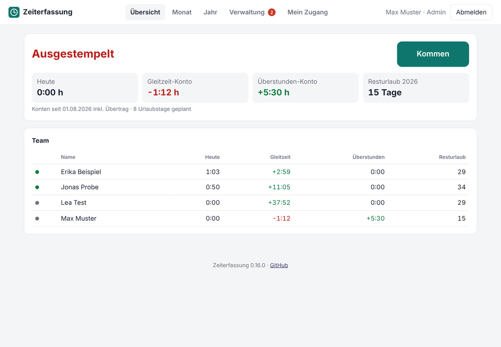
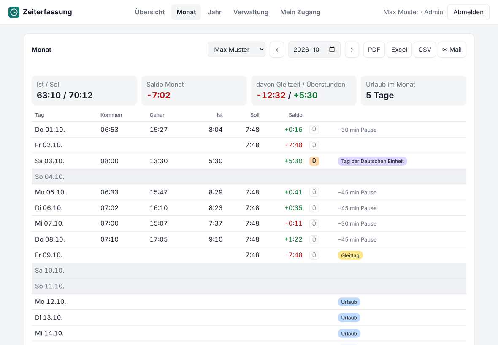
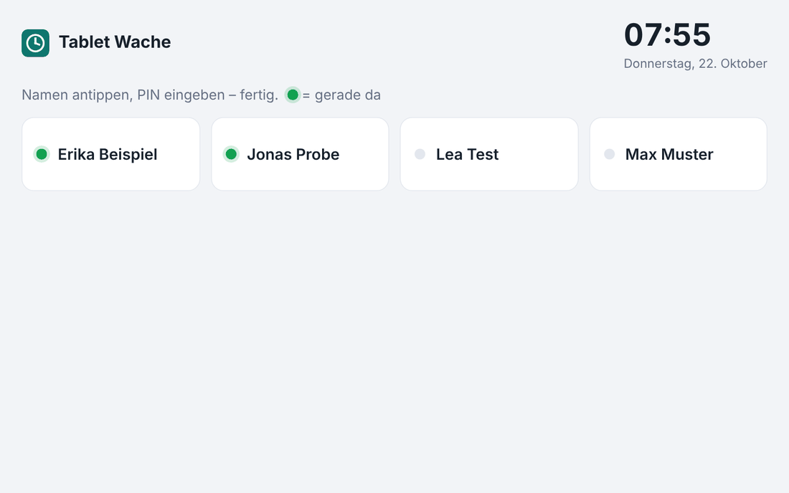
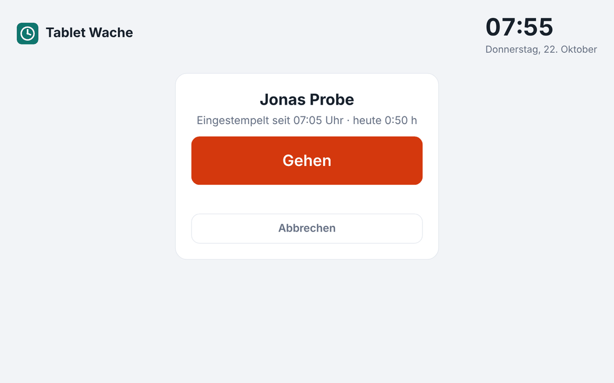
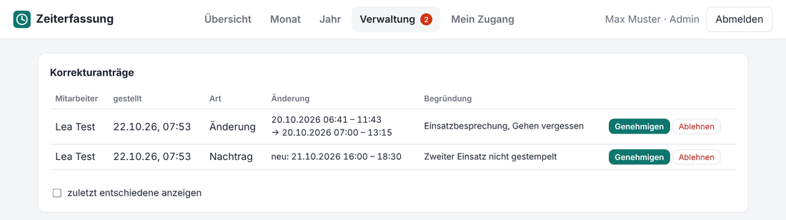
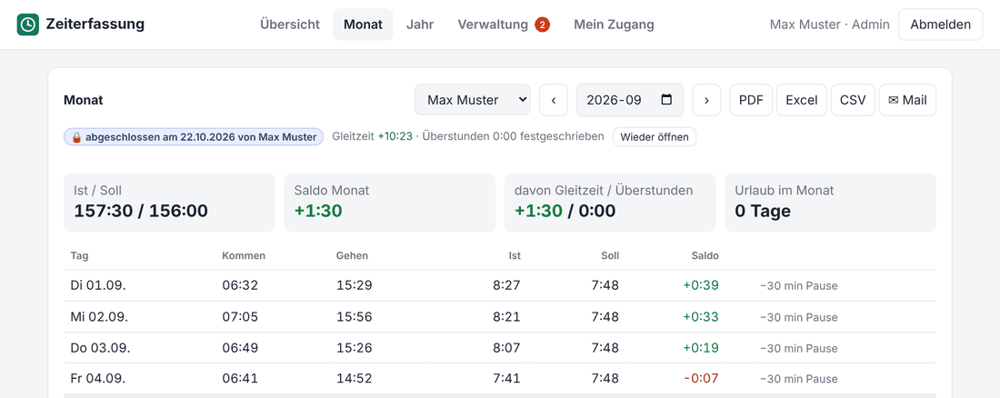
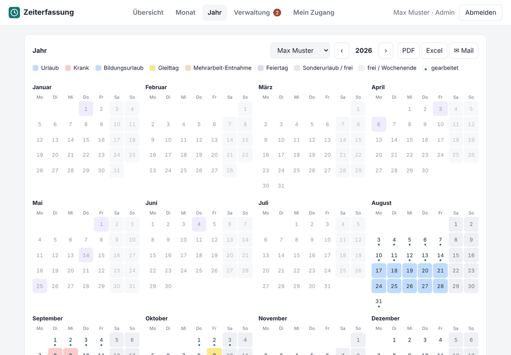
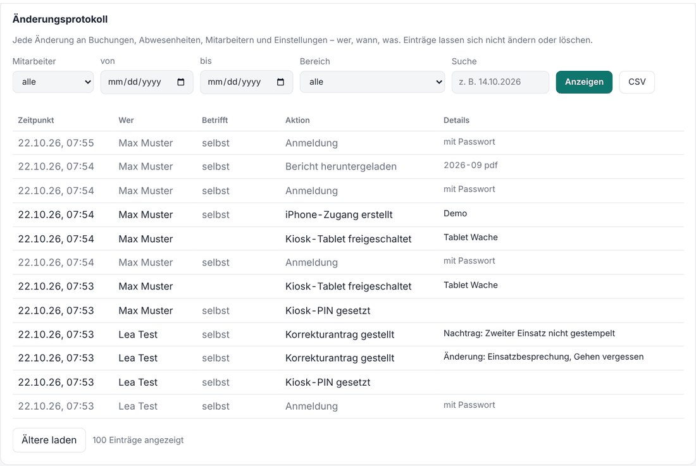
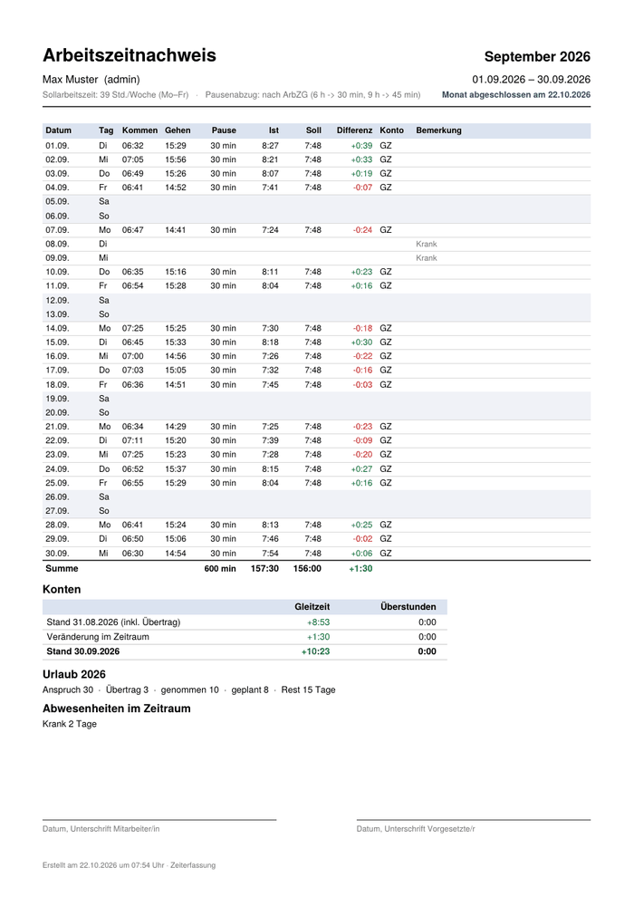
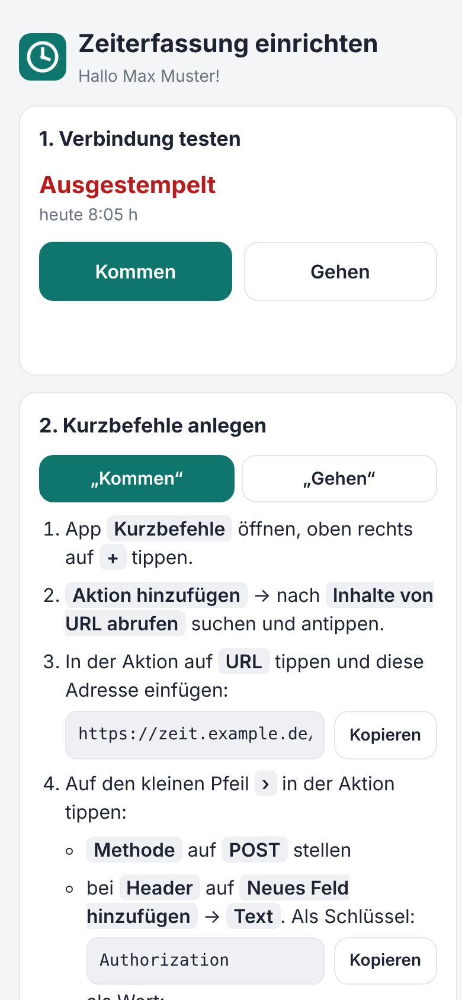

# Zeiterfassung für Synology

[](https://github.com/rinkelzz/zeiterfassung/actions/workflows/ci.yml)
[](https://github.com/rinkelzz/zeiterfassung/releases)
[](LICENSE)

Kommen/Gehen-Zeiterfassung für kleine Teams, die auf der eigenen Synology NAS läuft – als Paket
mit eigenem Fenster in DSM. Gestempelt wird im Browser, per iPhone-Kurzbefehl, automatisch beim
Ankommen (Standort) oder mit einem NFC-Aufkleber. Gleitzeit, Überstunden und Urlaub werden mitgeführt,
Berichte gibt es als PDF und Excel – auf Wunsch jeden Monat automatisch per Mail.

*English summary: [below](#english).*

| Übersicht mit Team | Monat mit Hinweisen und Ü-Tag |
|---|---|
|  |  |

| Kiosk-Tablet an der Wache | Kommen/Gehen nach PIN |
|---|---|
|  |  |

| Korrekturanträge | Monatsabschluss |
|---|---|
|  |  |

| Jahreskalender | Änderungsprotokoll |
|---|---|
|  |  |

| Arbeitszeitnachweis (PDF) | iPhone-Einrichtung |
|---|---|
|  |  |

> Alle Namen und Zahlen in den Screenshots sind erfunden.

## Inhalt

- [Funktionen](#funktionen)
- [Installation](#installation-auf-der-synology) · [Updates](#updates-über-das-paket-zentrum) ·
  [Datensicherung](#datensicherung) · [Von unterwegs (Reverse Proxy)](#von-unterwegs-erreichbar-machen-reverse-proxy) ·
  [iPhone & NFC](#iphone-und-nfc-einrichten) · [Kiosk-Tablet](#kiosk-tablet) · [Berichte per Mail](#berichte-per-mail) ·
  [Vergessenes Ausstempeln](#vergessenes-ausstempeln) · [Korrekturanträge](#korrekturanträge) ·
  [Monatsabschluss](#monatsabschluss)
- [Entwicklung](#entwicklung) · [Hinweise](#hinweise) · [Lizenz](#lizenz) · [English](#english)

## Funktionen

**Stempeln**
- Weboberfläche (auch am Handy), iPhone-Kurzbefehle, Standort-Automation, NFC-Aufkleber
- **Kiosk-Tablet** an der Wache: Name antippen, PIN eingeben, Kommen/Gehen – mit Anzeige, wer gerade da ist
- Einrichtung fürs iPhone per **QR-Code**: persönliche Seite mit Test-Knöpfen und Kopier-Feldern
- **Umschalten** mit einem einzigen NFC-Aufkleber (kommt, wenn draußen – geht, wenn drin)
- **Wegezeit**: für gewählte Stempelwege (z. B. NFC) beim Kommen früher und beim Gehen später, z. B. je 10 Minuten
- **Vergessenes Ausstempeln:** Erinnerung per Mail nach 12 Stunden, um Mitternacht automatisch beendet
  und als „bitte prüfen“ markiert
- Doppelte Auslöser sind harmlos; Dienste über Mitternacht werden sauber aufgeteilt (auch bei Zeitumstellung)

**Konten und Auswertung**
- **Gleitzeit- und Überstunden-Konto** getrennt: „Ü“-Tage schieben die Zeit über dem Tagessoll aufs Überstunden-Konto
- **Wochenarbeitszeit mit Verlauf** („ab 01.03. 30 Std. an Mo–Do“) – alte Monate bleiben richtig
- Urlaubskonto mit Resturlaub-Übertrag; Abwesenheiten (Urlaub, Krank, Bildungsurlaub, Gleittag,
  Mehrarbeit-Entnahme, Sonderurlaub), auch als halber Tag
- Feiertage aller 16 Bundesländer, betriebsfreie Tage, Erfassungsbeginn und Überträge pro Person
- Pausenabzug wählbar: keiner, nach ArbZG (über 6 h: 30 min, über 9 h: 45 min) oder fest
- **Hinweise nach Arbeitszeitgesetz:** über 10 Stunden am Tag (§ 3), unter 11 Stunden Ruhezeit (§ 5) –
  in Monatsansicht und Berichten markiert, abschaltbar
- Monatsansicht zum Korrigieren, Jahreskalender zum Eintragen von Abwesenheiten per Ziehen
- **Korrekturanträge:** Mitarbeiter beantragen Nachtrag, Änderung oder Löschung einer Buchung; der Admin
  genehmigt per Klick (wird übernommen) oder lehnt mit Begründung ab – mit Mail an beide Seiten
- **Monatsabschluss** pro Mitarbeiter: Monat sperren und Kontostände festschreiben, Wiederöffnen nur mit Begründung

**Berichte**
- **PDF**: Arbeitszeitnachweis pro Monat (mit Kontoständen und Unterschriftszeilen) und Jahresübersicht
- **Excel**: Monat mit allen Tagen; Jahr mit Monatssummen und einem Blatt pro Monat
- **Per Mail**: eigener SMTP-Server; automatisch am 1. des Monats (Vormonat) und am 1. Januar (Vorjahr),
  jeder Bericht nur einmal, mit Versandprotokoll – oder jederzeit von Hand
- CSV-Export, CSV-Import (z. B. aus [gleitzeit](https://github.com/rinkelzz/gleitzeit))
- **Änderungsprotokoll** in der Verwaltung: wer hat wann was geändert, filterbar nach Mitarbeiter,
  Zeitraum, Bereich und Suchtext, als CSV exportierbar

**Synology-Integration**
- Eigenes **DSM-Fenster** (kein neuer Tab) und **Single Sign-on** mit dem DSM-Konto
- Login-Formular akzeptiert auch DSM-Benutzer und -Passwort (inkl. Zwei-Faktor-Code); Sperre nach Fehlversuchen
  (5 pro Adresse bzw. 10 pro Benutzername in 15 Minuten)
- Läuft als eigener Paketbenutzer ohne Root-Rechte; alle Python-Bibliotheken sind im Paket enthalten

**Betrieb**
- **Updates über das Paket-Zentrum** – die App ist ihre eigene Paketquelle
- Nächtliche **Datensicherung** in einen freigegebenen Ordner (für Hyper Backup), Wiederherstellung per Klick

## Installation auf der Synology

Voraussetzung: DSM 7. Ein Paket für alle Modelle – **Intel/AMD** (z. B. DS918+, DS920+, DS1621+) und
**ARM** (ARMv8, z. B. DS223, DS124, DS220j; ARMv7, z. B. DS218j).

1. Unter [Releases](https://github.com/rinkelzz/zeiterfassung/releases) die neueste
   `zeiterfassung-<version>-0001-noarch.spk` herunterladen.
2. DSM → **Paket-Zentrum** → **Manuelle Installation** → SPK auswählen → Hinweis zu
   Drittanbieter-Paketen bestätigen.
3. Im Assistenten ein Passwort für den Benutzer `admin` und optional die öffentliche Adresse eintragen.
4. „Zeiterfassung“ erscheint im DSM-Hauptmenü. Wer in DSM angemeldet ist, ist es auch hier.

Das Paket nutzt das Python der NAS (3.8 bis 3.13). Fehlt es, bricht die Installation mit einem
Hinweis ab – dann im Paket-Zentrum „Python 3.9“ installieren. Daten liegen unter
`/var/packages/zeiterfassung/var/` und bleiben bei Updates erhalten. **Beim Deinstallieren werden sie
gelöscht** – deshalb die [Datensicherung](#datensicherung) einrichten.

Danach in dieser Reihenfolge: Updates, Datensicherung, Reverse Proxy, iPhone, Mail.

### Updates über das Paket-Zentrum

Die App ist ihre eigene Paketquelle (ab Version 0.8.1) – neue Releases von GitHub erscheinen im
Paket-Zentrum zum Aktualisieren. Einmalig einrichten:

1. **Paket-Zentrum → Einstellungen → Allgemein → Vertrauensebene:** „Beliebiger Herausgeber“
   (das Paket ist nicht von Synology signiert).
2. **Paket-Zentrum → Einstellungen → Paketquellen → Hinzufügen:** Name `Zeiterfassung`,
   Ort `http://127.0.0.1:8765/spk`.

Die App prüft etwa alle 30 Minuten (oder per „Jetzt prüfen“ unter Verwaltung → Updates), lädt eine
neue SPK auf die NAS und bietet sie dort an. Die Paketquelle antwortet nur im lokalen Netz.

### Datensicherung

Die App sichert die Datenbank jede Nacht (Standard 2 Uhr) und behält die letzten 7 Sicherungen im
Paketordner. Weil DSM diesen Ordner beim Deinstallieren löscht und Hyper Backup ihn nicht erfasst,
gehört zusätzlich ein **freigegebener Ordner** dazu:

1. **Systemsteuerung → Freigegebener Ordner** → z. B. `backup` → **Bearbeiten → Berechtigungen** →
   oben **System-interner Benutzer** wählen → `zeiterfassung` **Lesen/Schreiben** geben.
2. In der App unter **Verwaltung → Datensicherung** den Ordner eintragen, z. B. `/volume1/backup/zeiterfassung`
   (die App prüft die Schreibrechte), und die Aufbewahrung in Tagen festlegen (Standard 30).
3. Den freigegebenen Ordner in Hyper Backup aufnehmen.

Sicherungen lassen sich dort auch von Hand erstellen, herunterladen und wiederherstellen; vor dem
Wiederherstellen wird der aktuelle Stand automatisch gesichert. Die Sicherungen enthalten
Arbeitszeiten, Passwort-Hashes und das Mail-Passwort. Deshalb:

- Den Ordner **nicht für alle freigeben** – nur Admins und der System-Benutzer `zeiterfassung` brauchen Zugriff.
- In **Hyper Backup** beim Sicherungsauftrag die **Client-seitige Verschlüsselung** einschalten (vor allem bei
  Sicherungen in die Cloud oder auf USB-Platten).
- Optional den freigegebenen Ordner selbst **verschlüsseln** (Systemsteuerung → Freigegebener Ordner → Bearbeiten →
  Verschlüsselung).
- Fürs Mail-Passwort am besten ein eigenes Konto oder App-Passwort nur für den Versand verwenden.

### Von unterwegs erreichbar machen (Reverse Proxy)

Fürs iPhone unterwegs braucht die App eine eigene https-Adresse, z. B. `https://zeit.meinedomain.de`:

1. DNS-Eintrag für die Subdomain auf die NAS zeigen lassen (z. B. CNAME auf die DDNS-Adresse).
2. **Systemsteuerung → Sicherheit → Zertifikat**: Let's-Encrypt-Zertifikat für die Subdomain.
3. **Systemsteuerung → Anmeldeportal → Erweitert → Reverse Proxy**: Quelle `HTTPS zeit.meinedomain.de:443`,
   Ziel `HTTP localhost:8765`.
4. In der App unter **Verwaltung → Einstellungen → Öffentliche Adresse** genau diese Adresse eintragen
   und danach neue QR-Codes erzeugen.

Die Adresse von DSM selbst (z. B. `https://nas.meinedomain.de`) ist **nicht** die richtige – die App braucht ihre eigene.

**Wichtig:** Port 8765 im Router **nicht** direkt freigeben – dann laufen Passwörter unverschlüsselt durchs Internet.
Greift jemand per `http://` von außerhalb des Heimnetzes zu, zeigt die App oben einen gelben Warnhinweis.

### iPhone und NFC einrichten

Unter **Mein Zugang → QR-Code erzeugen** und mit der iPhone-Kamera scannen. Die Einrichtungsseite
erklärt Schritt für Schritt die Kurzbefehle „Kommen“/„Gehen“, die Standort-Automation und NFC.
Technisch ist es jeweils ein `POST` mit `Authorization: Bearer <token>`. Diese Schlüssel gelten **nur zum
Stempeln** – geht ein Handy oder NFC-Aufkleber verloren, kommt damit niemand an Konten, Berichte oder die
Verwaltung. Trotzdem das verlorene Gerät unter „Mein Zugang“ bzw. in der Verwaltung sperren.

| Zweck | Adresse |
|---|---|
| Kommen | `<server>/api/v1/clock/in` |
| Gehen | `<server>/api/v1/clock/out` |
| Umschalten (ein NFC-Aufkleber) | `<server>/api/v1/clock/toggle?source=nfc` |
| Status (`GET`) | `<server>/api/v1/clock/status` |

Die Antwort enthält `message` (z. B. „Eingestempelt um 07:02 Uhr“). Mit den Kurzbefehl-Aktionen
„Wörterbuchwert abrufen“ (Schlüssel `message`) und „Mitteilung anzeigen“ erscheint sie als Mitteilung.

**NFC:** Kurzbefehle → Automation → NFC → Aufkleber scannen → „Sofort ausführen“. Mit einem Aufkleber
die Umschalt-Adresse verwenden (dann **ohne** Standort-Automation), mit zwei Aufklebern Kommen und Gehen
getrennt. Für Metallflächen werden **On-Metal-NFC-Aufkleber** (mit Ferrit-Schicht) benötigt. Die
**Wegezeit** (Verwaltung → Einstellungen) wird standardmäßig nur bei NFC-Stempeln dazugerechnet.

### Kiosk-Tablet

Für ein Tablet an der Wache (oder für Kollegen ohne iPhone):

1. **Verwaltung → Kiosk-Tablets → Tablet freischalten** und den QR-Code mit dem Tablet scannen
   (oder den Link dort öffnen). Die Seite am besten „Zum Home-Bildschirm“ hinzufügen.
2. Jeder Mitarbeiter setzt unter **Mein Zugang → PIN fürs Kiosk-Tablet** eine 4–6-stellige PIN.
   Nur wer eine PIN hat, erscheint am Tablet.
3. Am Tablet: Namen antippen, PIN eingeben, **Kommen** bzw. **Gehen**. Ein grüner Punkt zeigt, wer gerade da ist.

Nach 5 falschen PINs ist der Name 15 Minuten gesperrt. Ein verlorenes Tablet lässt sich in der Verwaltung
sperren, eine vergessene PIN in der Mitarbeitertabelle löschen.

### Berichte per Mail

**Verwaltung → Berichte per Mail**: SMTP-Server eintragen (z. B. Port 587 mit STARTTLS oder 465 mit SSL),
Testmail senden, dann „Monatsbericht automatisch“ bzw. „Jahresbericht automatisch“ einschalten.
Jeder Mitarbeiter braucht eine Mailadresse (Spalte „E-Mail“ in der Verwaltung oder selbst unter „Mein Zugang“).
Bei GMX, Web.de oder Gmail meist ein **App-Passwort** verwenden.

### Vergessenes Ausstempeln

Läuft eine Buchung länger als 12 Stunden, bekommen der Mitarbeiter und alle Admins mit Mailadresse
eine Erinnerung (dafür muss der Mailversand eingerichtet sein). Ist sie um Mitternacht noch offen,
endet sie zur Grenze (z. B. Kommen 06:50 → Gehen 18:50) und der Tag ist in Monatsansicht, PDF und
Excel mit „⚠ bitte prüfen“ markiert, bis ein Admin die Buchung korrigiert. Grenze und automatisches
Beenden lassen sich unter **Verwaltung → Einstellungen** ändern oder abschalten (0 Stunden = aus).

### Korrekturanträge

Mitarbeiter können ihre Buchungen nicht selbst ändern. Stattdessen tippen sie in der **Monatsansicht**
auf den Tag und beantragen mit Begründung einen Nachtrag, eine andere Kommen-/Gehen-Zeit oder das
Löschen einer Buchung. Admins bekommen eine Mail (wenn Mailversand und Adresse eingerichtet sind) und
sehen offene Anträge unter **Verwaltung → Korrekturanträge** – die Zahl steht auch am Reiter.
**Genehmigen** übernimmt die Änderung, **Ablehnen** geht mit kurzer Begründung; der Mitarbeiter bekommt
die Entscheidung per Mail und sieht seine Anträge unter **Mein Zugang**.

### Monatsabschluss

Nach Prüfung (und ggf. Unterschrift unter dem PDF) schließt ein Admin den Monat ab – in der
Monatsansicht mit **🔒 Monat abschließen** oder unter **Verwaltung → Monatsabschluss** für alle
Mitarbeiter bis zu einem Monat. Danach sind Buchungen, Abwesenheiten, Ü-Tage und der Arbeitszeit-Verlauf
in diesem Monat gesperrt, und die Kontostände am Monatsende sind festgeschrieben. Abgeschlossen wird der
Reihe nach; **Wieder öffnen** geht beim zuletzt abgeschlossenen Monat mit Begründung (Änderungsprotokoll).

## Entwicklung

```bash
pip install -r requirements-dev.txt
python -m app.main          # http://localhost:8765, API-Doku unter /docs
pytest
```

Beim ersten Start wird `admin` angelegt; das Passwort steht in `data/ERSTES_ADMIN_PASSWORT.txt`
(oder vorher `ZE_ADMIN_PASSWORD` setzen).

| Variable | Standard | Zweck |
|---|---|---|
| `ZE_DATA_DIR` | `./data` | Ordner für die SQLite-Datenbank |
| `ZE_PORT` | `8765` | Port |
| `ZE_PUBLIC_URL` | leer | Öffentliche Adresse (die Einstellung in der App hat Vorrang) |
| `ZE_ROOT_PATH` | leer | Unterpfad hinter einem Proxy, z. B. `/zeiterfassung` |
| `ZE_COOKIE_SECURE` | `0` | `1`, wenn nur per HTTPS erreichbar |
| `ZE_TIMEZONE` | `Europe/Berlin` | Tagesgrenzen und Anzeige |
| `ZE_ADMIN_PASSWORD` | – | Startpasswort für den ersten Admin |
| `ZE_MAIL_SCHEDULER` | `1` | Hintergrundaufgaben an/aus (Berichte per Mail, Erinnerungen, Datensicherung, Update-Prüfung) |
| `ZE_UPDATE_CHECK` | `1` | bei GitHub nach neuen Versionen sehen (Paketquelle) |
| `ZE_UPDATE_REPO` | `rinkelzz/zeiterfassung` | Repo, aus dem Updates kommen |

**Aufbau:** FastAPI + SQLite (`app/`), Oberfläche ohne Build-Schritt (`app/static/`). Berechnung der
Konten in `app/reports.py` (ab dem letzten Monatsabschluss, `app/closing.py`), Berichte in `app/report_files.py` (PDF ohne Fremdbibliothek über `app/pdf.py`,
Excel mit openpyxl). Hintergrundaufgaben laufen alle 10 Minuten in einem Thread (`app/mailer.py`):
Mailversand, Erinnerungen (`app/forgotten.py`), Datensicherung (`app/backup.py`) und Update-Prüfung
(`app/updates.py`). Das Synology-Paket liegt unter `synology/`:
`ui/Zeiterfassung.js` ist die native DSM-App (Ext JS), `ui/app.cgi` → `proxy/dsm_proxy.py` reicht die
Anfragen über den Webserver von DSM weiter und übernimmt die DSM-Anmeldung.

**Paket bauen:** `./synology/build_spk.sh` → `dist/zeiterfassung-<version>-0001-noarch.spk`
(lädt die Bibliotheken für Python 3.8–3.13 von PyPI; reines Python unter `lib/<cp>`, kompilierte
Teile – nur `pydantic_core` – je Prozessor unter `lib/<cp>-x86_64|aarch64|armv7l`). **Release:** Version in `app/__init__.py` und
`CHANGELOG.md` anpassen und committen, dann auf GitHub unter **Actions → Release → Run workflow**
starten (oder Tag `v<version>` pushen) – GitHub Actions testet, baut die SPK und erstellt das Release.

## Hinweise

- Kein offizielles Synology-Produkt. Synology und DSM sind Marken der Synology Inc.
- Die Software hilft bei der Arbeitszeiterfassung, ersetzt aber keine rechtliche Prüfung
  (Arbeitszeitgesetz, Betriebsrat, Datenschutz). Nutzung auf eigene Verantwortung.
- Sicherheitslücken bitte nicht öffentlich melden – siehe [SECURITY.md](SECURITY.md).

## Lizenz

[GNU General Public License v3.0](LICENSE). Wer die Software verändert weitergibt, muss den
Quellcode unter derselben Lizenz offenlegen.

---

## English

**Zeiterfassung** is a self-hosted clock-in/clock-out time tracker for small teams, packaged for
Synology DSM 7 – one package for Intel/AMD and ARM (ARMv8, ARMv7) models. The user interface is German.

- Clock in via web UI, iPhone Shortcuts (setup via QR code), geofence automation, NFC tags or a
  kiosk tablet (name + PIN, shows who is present); optional travel-time allowance
- Forgotten clock-outs: email reminder after 12 hours, auto-close at midnight, flagged for review
- Separate flextime and overtime accounts, weekly hours with effective dates, vacation tracking,
  public holidays for all 16 German states, break deduction per German working-time law (ArbZG)
- Working-time-law hints: more than 10 hours a day, less than 11 hours rest between working days
- Correction requests: employees request adding, changing or deleting a punch; admins approve (applied
  automatically) or reject with a reason, with email notifications
- Month closing per employee: locks the month and freezes the account balances (reopen with a reason)
- Monthly and yearly reports as PDF and Excel, delivered automatically by email (own SMTP server)
- Runs in its own DSM window with single sign-on for DSM users; login with DSM credentials incl. 2FA
- Nightly database backup to a shared folder (for Hyper Backup) with one-click restore
- Updates through the Package Center: the app serves as its own package source
- Python/FastAPI + SQLite, no external database; all dependencies bundled in the SPK

**Install:** download the `.spk` from [Releases](https://github.com/rinkelzz/zeiterfassung/releases),
then DSM → Package Center → Manual Install. Afterwards:
- *Updates:* Package Center → Settings → General → trust level "Any publisher"; Settings → Package Sources →
  add `http://127.0.0.1:8765/spk`.
- *Backup:* give the system user `zeiterfassung` read/write access to a shared folder and enter it under
  *Verwaltung → Datensicherung* (the package folder is deleted on uninstall). Backups contain password hashes
  and the SMTP password – keep the folder private and enable client-side encryption in Hyper Backup.
- *Remote access:* DSM reverse proxy (`https://time.example.com` → `http://localhost:8765`), then enter that
  address under *Verwaltung → Einstellungen → Öffentliche Adresse*. Never forward port 8765 directly.
- *Shortcut/NFC tokens* can only clock in/out; they cannot access reports or administration.

**Develop:** `pip install -r requirements-dev.txt && python -m app.main` (API docs at `/docs`), `pytest` to run the tests.

Not affiliated with Synology Inc. Licensed under the [GPL-3.0](LICENSE).
